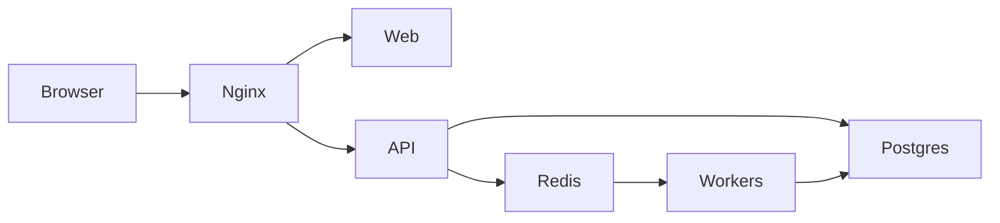

# Architecture

- `apps/web` is the Next.js App Router UI. It calls `/api/v1` with httpOnly session cookies and a readable CSRF cookie.
- `apps/api` is NestJS. Prisma talks to PostgreSQL 16. BullMQ workers run in the API process for free-period conversion, recurring invoices, commission, and webhooks.
- `packages/shared` holds Zod schemas and role labels.
- `deploy` holds Compose, Nginx, backups, and the update script.

User hierarchy is `parentId`. Admin sees everyone. A distributor sees their subtree. An operator sees themself and their customers. A customer sees themself. Connections, invoices, and reports filter by the customer ids in that scope.
